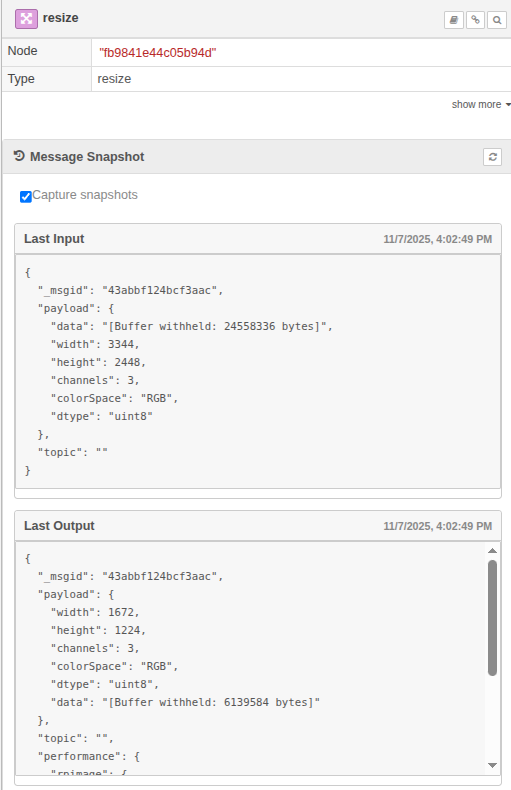

# Message Control for Node-RED

`@rosepetal/node-red-contrib-message-control` provides a runtime plugin for Node-RED that remembers the last messages each node received and sent, with a short timestamped history, and shows them in the editor's Information sidebar and over an HTTP API. It adds no nodes to the palette.

## Installation

```bash
cd ~/.node-red
npm install @rosepetal/node-red-contrib-message-control
```

Restart Node-RED afterwards: the plugin is loaded when the runtime starts. It works without configuration; the optional settings are listed under [Configuration](#configuration).

## Requirements

- Node-RED >= 3.0. The plugin uses the `RED.hooks` runtime API and does not start without it.
- With admin authentication enabled (`adminAuth`), the `flows.read` permission to see the snapshots, and `flows.write` to change the capture settings (the pause switch included) or send a message to a node.

## Reference

| Page | Contents |
|------|----------|
| **[HTTP API reference](./http-api.md)** | The admin routes under `/rosepetal/message-control`: permissions, the data model, parameters and example responses |

## What it does

- **Last input and output of every node**: select a node in the editor and the Information sidebar shows the most recent sampled message it received and the most recent one it sent, without wiring debug nodes.
- **Short history**: the last sampled messages per node and direction (10 by default) are kept with their capture time, under a global memory budget (16 MB by default).
- **Sends to outputs without wires**: Node-RED drops a message sent to an output that has no wires; the plugin records it too, with the output port.
- **Bounded snapshots**: a snapshot is a cleaned copy of the message. Buffers, typed arrays, long base64 strings and image data URLs become placeholders that state the original size (`[Buffer withheld: 24558336 bytes]`), streams and sockets become a placeholder with their type, and long strings, arrays and objects are cut at fixed limits.
- **Built to stay enabled**: per message the hooks only update counters and a timestamp. A snapshot is taken at most once per `captureInterval` per node and direction (250 ms by default) and within a global CPU budget (`captureBudget`, 5 ms per second by default). The hooks never return a value and never let an exception escape, so Node-RED cannot halt or fail a message because of the plugin.
- **Pause switch**: one toggle removes the hooks from the message router and clears the stored snapshots.
- **HTTP API**: the same data, the capture settings and runtime statistics are available on the Node-RED admin API, for scripts, tests and tools.
- **Runtime tools over HTTP**: the last lines of Node-RED's log (2000 by default), filtered by level, text, node, type and time; read-only listing, search and reading of the files of the packages installed in the user directory and of the core nodes; and delivery of a message to the input of a running node, as a wire would.

[How it works](../README.md#how-it-works) and [Measured overhead](../README.md#measured-overhead) in the README describe the capture mechanism and its cost on a real runtime.

## Snapshots in the editor

1. Open the **Information** sidebar.
2. Click a node on the canvas.
3. A **Message Snapshot** card appears below the node's properties; scroll the panel if it is short. It has two sections:
   - **Last Input**: the most recent sampled message the node received.
   - **Last Output**: the most recent sampled message it sent.



The card is loaded when the node is selected; its refresh button loads it again without changing the selection. It is not shown for tabs, groups and subflow instances, nor when several nodes are selected. Each section shows the capture time of its snapshot. When the node is busier than the capture interval, the section also shows how many newer messages were not sampled (`+3 newer not sampled`), and when the last output went to an output without wires, it says which output (`output 2 has no wires`, counted from 1).

When there is nothing to show, the card says so:
- *No input captured for this node yet.* / *No output captured for this node yet.*: the node is deployed, but no message has been sampled in either direction. When only one section is empty, it says *No data captured yet.*
- *No snapshots recorded for this node yet.*: the plugin does not know this node id, for example a node that is not deployed.
- *Unable to load snapshot.*: the request failed, for example because the user lacks the `flows.read` permission.

The **Capture snapshots** checkbox at the top of the card pauses the capture: the hooks are removed from the message router and the stored snapshots are cleared. It applies to the whole runtime, not only to the selected node; an editor already open elsewhere shows the new state of the checkbox once it is reloaded. While the capture is paused the card shows the message *Snapshots paused. Enable capture to resume.* Tick the checkbox again to resume.

The card shows the last input and the last output. The history is available over HTTP, with `GET /nodes/:id?history=N`.

## Configuration

Every key is optional. In `settings.js`:

```js
plugins: {
  '@rosepetal/node-red-contrib-message-control': {
    captureEnabled: true,   // start capturing on boot (default true)
    captureInterval: 250,   // ms between two snapshots of the same node & direction; 0 = every message
    captureBudget: 5,       // ms of snapshot CPU allowed per second across all nodes; 0 = unlimited
    historySize: 10,        // snapshots kept per node and direction (0-100); 0 = only the last one
    historyMaxBytes: 16777216, // global memory budget of the history (estimated bytes)
    captureUnwired: true,   // also record messages sent to outputs without wires
    logBufferSize: 2000,    // log entries kept for GET /logs (0 = no log buffer, at most 100000)
    logLevel: 'info',       // most verbose level kept: fatal|error|warn|info|debug|trace
    moduleFiles: true,      // read-only access to installed module files (GET /module-files…)
    sendToNode: true,       // POST /send delivers messages to node inputs
    snapshotLimits: {       // hard caps applied to every snapshot
      maxDepth: 6, maxArrayLength: 50, maxObjectKeys: 60,
      maxStringLength: 2048, maxValues: 2000, maxChars: 262144
    }
  }
}
```

A value that is not valid (a negative number, a string where a boolean is expected) is ignored and the default applies; a number above its maximum (3600000 for `captureInterval`, 1000 for `captureBudget`, 100 for `historySize`, 1073741824 for `historyMaxBytes`) is lowered to it.

Restart Node-RED to apply a change of `settings.js`. The capture switch (`enabled`), `captureInterval`, `captureBudget`, `historySize`, `historyMaxBytes` and `captureUnwired` can also be changed while Node-RED runs, with `POST /settings`: those changes are kept in memory only, and a restart returns to the values of `settings.js`. Pausing the capture does not stop the log buffer, the module files routes or `POST /send`.

## HTTP API

Every route is on the Node-RED admin server (usually `http://localhost:1880`, under `httpAdminRoot` when it is set), under `/rosepetal/message-control`. With admin authentication enabled, `GET` routes require the `flows.read` permission and `POST` routes `flows.write`; send the admin access token in an `Authorization: Bearer` header.

| Route | Purpose |
|-------|---------|
| `GET /nodes` | List the known nodes with their counters and timestamps |
| `GET /nodes/:id` | Last input and output of one node; `?history=N` adds its history |
| `GET /settings`, `POST /settings` | Read the capture settings; pause or resume the capture and change the sampling limits at runtime |
| `GET /stats` | Runtime statistics of the plugin: messages seen, snapshots taken and skipped, time spent |
| `GET /logs` | The last lines of Node-RED's log, filtered by level, text, node, type and time |
| `GET /module-files`, `GET /module-files/search`, `GET /module-files/read` | List, search and read the files of an installed package, read-only |
| `POST /send` | Deliver a message to the input of a running node, as a wire would |

```bash
# Last input and output of a node, with the 5 most recent snapshots of each direction
curl "http://localhost:1880/rosepetal/message-control/nodes/<node-id>?history=5"

# Pause the capture ("enabled": true resumes it)
curl -X POST -H "Content-Type: application/json" -d '{"enabled": false}' \
  http://localhost:1880/rosepetal/message-control/settings

# Deliver a message to the input of a node
curl -X POST -H "Content-Type: application/json" -d '{"id": "<node-id>", "msg": {"payload": 42}}' \
  http://localhost:1880/rosepetal/message-control/send
```

A message delivered with `POST /send` is processed by the node for real: everything the node does downstream happens.

Parameters, response fields and error codes of every route are in the [HTTP API reference](./http-api.md).

## Limitations

- Snapshots live only in memory. Restarting Node-RED clears them, and a deploy drops the nodes that no longer exist.
- Under sustained load a snapshot is a sample, not necessarily the very last message. The card shows how many newer messages were not sampled, and the HTTP API has the counters (`inputSkipped`, `outputSkipped`). Set `captureInterval: 0` and `captureBudget: 0` while debugging a quiet flow to snapshot every message (a snapshot that takes more than 2 ms still pauses that node for 10 s).
- Only the nodes of the deployed flows, plus the runtime nodes that have processed a message since the capture was enabled, appear.
- Nodes inside a subflow: the editor shows the subflow's definition, and the running copies of its nodes have other ids, so the card stays empty for them. `GET /nodes` lists the running copies under their own ids once they have processed a message after the last deploy.

## License

Apache-2.0.

The package is published on npm as [`@rosepetal/node-red-contrib-message-control`](https://www.npmjs.com/package/@rosepetal/node-red-contrib-message-control).
